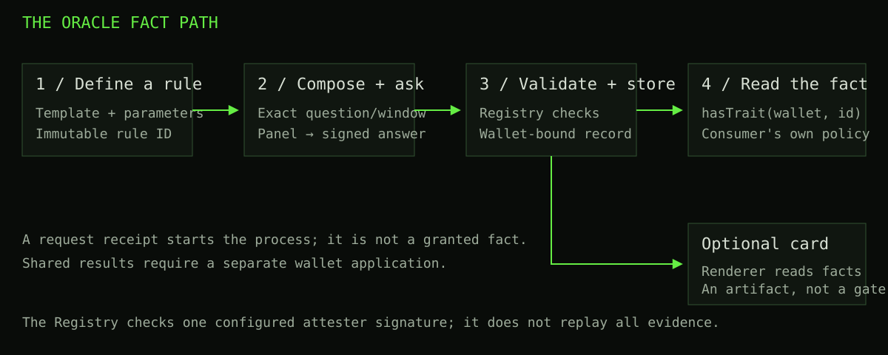
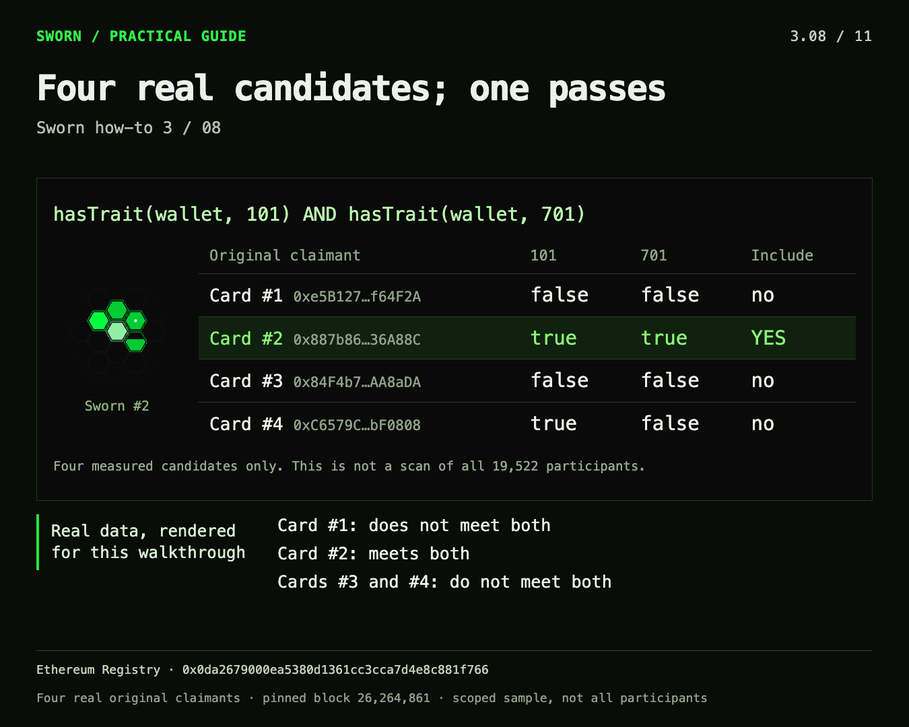
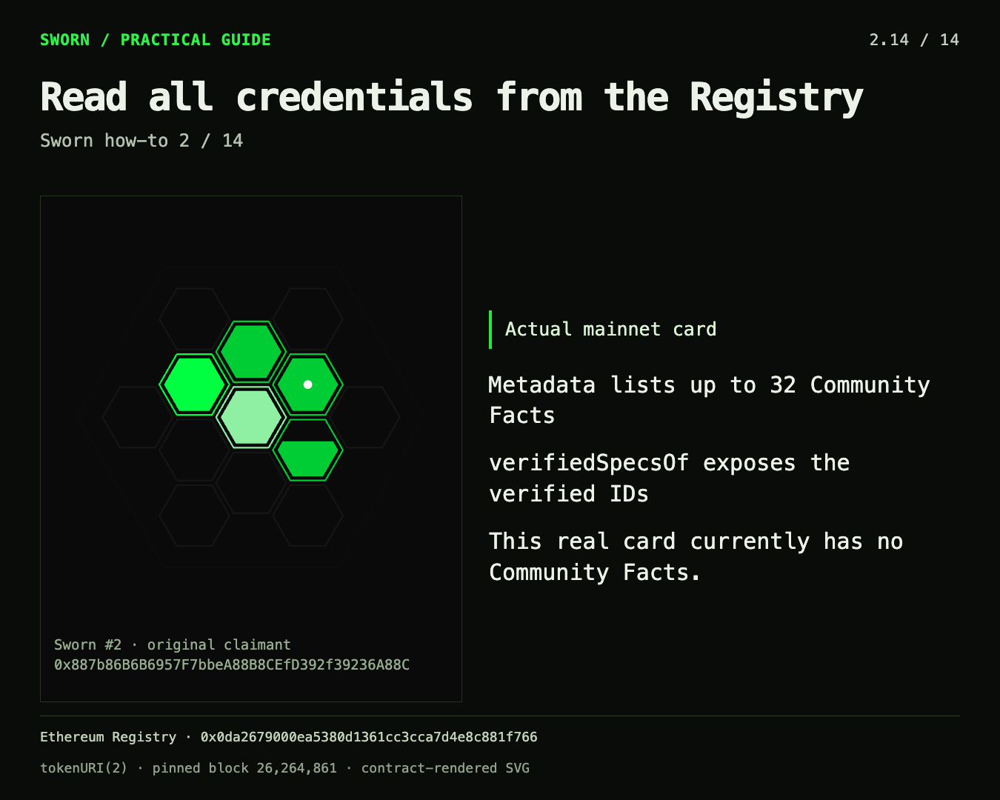

# Sworn handbook

Edition: 2026-10-25

# Sworn documentation

Sworn makes a defined statement about an Ethereum wallet available to other applications through a contract read. Some statements come directly from WhitelistCurator. Others require an IMD oracle answer that passes the Registry’s checks. A collectible card can render the wallet’s facts, but a wallet does not need a card to hold or use them.

This handbook explains how to use that system, what is distinctive about its design, and when a simpler mechanism may be a better fit. It documents the launch-2404 contracts at source commit `c4ff3238390fc51962fb67e86affc20cf418126e`, with a separate explanation of the revised local mock. It does not report a fresh mainnet-state audit or endorse a payment. [Pinned contract source](https://github.com/identity-md-launches/launch-2404-renderer-composer-registry/tree/c4ff3238390fc51962fb67e86affc20cf418126e).

## Start with three distinctions

| Term | Meaning | What it does not mean |
| --- | --- | --- |
| Rule | An immutable definition of what to check, including the evidence window and supported template. | A wallet has already satisfied it. |
| Fact | A predicate the authentic Registry currently reports for a wallet. Oracle facts require accepted evidence. | A free-floating claim, a guaranteed truth, or a unique-human identity. |
| Card | A transferable visual artifact associated with its original claimant. | Transferable ownership of that claimant’s credentials. |

The revised interface calls the tasks **Mint Card**, **Mint Facts**, and **Mint Rule**. “Mint Facts” means recording an accepted wallet fact in the Registry contract. It does not put a fact inside an NFT: the card reads the Registry when producing its artwork. Submission alone does not establish a fact; only an accepted stored result does. A shared result must also be applied to the wallet. [User guide](guide.html).

## How the pieces connect



For a direct fact, the Registry uses the Curator-based read or the wallet’s frozen mint snapshot instead of an oracle. The diagram’s panel path describes oracle facts. The Registry authenticates a configured signer and validates the answer’s bindings; it does not independently replay the entire historical computation. [Architecture and trust assumptions](architecture.html).

## Choose a reading path

- **I want to understand or use Sworn:** start with the [user guide](guide.html). It covers the Curator origin, fact classes, minting, community examples, the card and recovery.
- **I want to assess the design:** read [architecture and alternatives](architecture.html). It compares Merkle allowlists, signed vouchers, NFT gates, attestation registries and cryptographic proofs without claiming that one replaces all the others.
- **I want to integrate it:** use [Build with Sworn](builders.html). It includes read signatures, an authenticated-wallet gate, a reproducible allowlist procedure and the shared-list delivery path.
- **I need exact names and limits:** use the [reference](reference.html), including the deployment, catalog, template limits and source inventory.

The **Full handbook** link combines the chapters into one printable document. The Markdown download contains the same text. Search works locally over the bundled chapters; it sends no query to an external service.

## Why this design may be useful

Consider two projects that both want to recognize wallets that participated in a historical activity. Each could publish its own list. Sworn instead offers a common predicate whose rule and accepted evidence can be inspected and reused. Projects still choose their own eligibility policy; sharing a predicate does not force them to share a distribution or trust every fact.

That separation is the central idea: define the question once, preserve its evidence context, and let several consumers read the same wallet-level result. The optional card makes those facts visible without becoming the authorization mechanism. This is a design combination, not a claim that registries, oracles, NFTs or reusable attestations were invented by Sworn.

There are costs. Oracle results depend on the configured service and signer. A historical fact is not a continuously refreshed balance. Public predicates disclose information. For a one-off distribution to an already agreed list, a Merkle tree can be simpler and cheaper to operate. A useful hybrid is to evaluate Sworn predicates at one block, apply a project’s allocation policy, and publish that exact snapshot as a Merkle root. [Decision guide](architecture.html).

## Try the local version

The [revised local mock](http://127.0.0.1:8799/#/mint) demonstrates delayed wallet transactions, panel progress, community rules, card rendering and curator consumption. It uses synthetic data, eight known wallet fixtures and scripted oracle outcomes. The close button hides a verification overview without deleting its result from Review transaction steps. Its artwork approximates parts of the deployed Renderer.

The mock’s successful journey is an interface demonstration. It is not a mainnet credential, a real oracle run, a complete Ethereum wallet index or a production safety certificate. The documentation itself never connects a wallet or submits a request. The [public Sworn site](https://swornbyswarm.sites.imd.fun/) is a separate deployment, and its interface may differ from the local revision.

## Reused material and evidence dates

This edition builds on the three earlier how-to threads, the content/storyline review, the four-wallet worked example, the verified community-template examples, and the mint/curator reviews. Their useful explanations are retained; stale language and mock limitations are corrected.

The reused chain examples are explicitly dated **24 October 2026, Ethereum block 26,264,861**. They are historical observations, not automatically refreshed claims about today. In particular, the old example showing no community facts does not establish that no community facts exist now. [Source and evidence inventory](reference.html).

---

# Understand and use Sworn

Sworn makes specific facts about Ethereum wallets readable by other applications. You can inspect a wallet, verify a historical condition, define a reusable rule, or use accepted facts to decide access. An optional NFT card displays the original wallet’s record. You do not need a card to hold or consume a fact.

This guide describes the contract source pinned at `c4ff3238390fc51962fb67e86affc20cf418126e` and the revised local interface. The named deployment is Ethereum mainnet Registry `0x0da2679000ea5380d1361cc3cca7d4e8c881f766`. The documentation is not a fresh deployment audit or a current wallet-state report. [Published contract task](https://explorer.imd.fun/jobs/2759fb3d-89a9-4c2f-a5e3-6472208fac0e).

## Start with a wallet question

Begin with the decision you want to make: “Did this wallet participate?”, “Did it deposit during a particular window?”, or “Does it have a stored verification of this community rule?” Sworn answers defined predicates. Your application decides whether those predicates are useful for its own mint, grant, access policy or research.

Read a wallet before paying for anything. A public address lookup does not require connecting that wallet. Look at the rule, evidence window and result state together. “No accepted fact” is different from “the historical statement is false”; an RPC failure is different again. A screenshot or green card cell is useful for navigation, but the authentic Registry’s state is the credential. [Concept and integration model](https://github.com/identity-md-launches/launch-2404-renderer-composer-registry/blob/c4ff3238390fc51962fb67e86affc20cf418126e/CONCEPT.md).

The revised interface separates three tasks:

| Task | What you obtain | What it does not do |
| --- | --- | --- |
| **Mint Card** | One optional transferable Sworn NFT describing its original wallet | It does not start oracle verification or transfer wallet credentials to later owners |
| **Mint Facts** | An accepted wallet fact recorded in the Registry after verification, or application of an accepted shared result | It does not create another NFT or put a separate token inside the card |
| **Mint Rule** | An immutable, reusable community definition with a rule ID | It does not establish that any wallet meets the rule |

“Mint Facts” is interface terminology for recording accepted facts in the contract. The card reads those facts from the Registry to render its artwork. A submitted request is not yet a minted fact. In the local mock, every transaction and result is simulated.

## Where Sworn comes from

The initial catalog uses the WhitelistCurator onchain attention game, which ran on Ethereum mainnet in August 2026. Over 66 hours, 19,522 participating wallets left a record of timing, repeated deposits, largest sends and points. The game returned deposits in the same transaction; the persistent output was the activity record rather than retained principal. [WhitelistCurator source and developer notes](https://etherscan.io/address/0xcb0b0531e86a9ac36fa865ca8e3dbccf047fda91#code), [catalog and historical windows](https://github.com/identity-md-launches/launch-2404-renderer-composer-registry/blob/c4ff3238390fc51962fb67e86affc20cf418126e/CATALOG.md).

That record can support many different lists. A project might value early participation; another might prefer continued activity or a particular historical event. Sworn supplies named predicates and evidence records so each consumer can express its own policy. It does not declare one universal allowlist.

Participation is not proof of a unique person. Refunded ETH can be reused, and one person can control several wallets. A fact about a largest send is not a statement of current wealth. Community Facts can also describe supported Ethereum evidence outside WhitelistCurator: belonging to the original 19,522-wallet census is not a universal Sworn requirement.

## Keep rules, facts, cards and owners separate

A **rule** specifies the question: its template, contract, event or function, threshold and evidence window. A **wallet fact** records that the authentic Registry accepts the relevant predicate for an address. A **card** displays the record of the wallet that minted it. The **current NFT owner** may be someone else.

The original wallet is the claimant. `claimantOf(tokenId)` identifies it permanently; `ownerOf(tokenId)` identifies whoever currently owns the collectible. Transferring a card changes the latter, not the former. The original wallet cannot mint a second card after transferring the first. Its accepted facts remain associated with it. [Registry mint and ownership behavior](https://github.com/identity-md-launches/launch-2404-renderer-composer-registry/blob/c4ff3238390fc51962fb67e86affc20cf418126e/src/Registry.sol).

Consumers use `hasTrait(wallet, id)` to check a fact. They do not require `tokenOf(wallet)` to be nonzero. If a user supplies a card, resolve its claimant first. If an application grants access to the caller, authenticate that caller; letting someone type an arbitrary qualifying address does not prove they control it.

The card is also not a continuously refreshed record of every direct condition. Before a wallet mints, direct facts are read from the underlying Curator getters. Mint Card saves their result, and subsequent direct checks for that original wallet use its frozen snapshot. Accepted oracle facts can still be added later. [Direct snapshot and `hasTrait`](https://github.com/identity-md-launches/launch-2404-renderer-composer-registry/blob/c4ff3238390fc51962fb67e86affc20cf418126e/src/Registry.sol).

## Understand the evidence classes

The catalog has 25 built-in facts across 13 visual families. Community Facts extend the available rules through existing templates; they are not a fifth evidence class. Both chain-proven and panel-sworn routes involve agents. “Chain-proven” names the configured evidence route, not an Ethereum consensus proof of all historical computation.

| Class | Example and evidence | Panel for this deployment |
| --- | --- | --- |
| **Direct facts** | Spawned 101 reads whether the wallet joined Curator. Other direct rules cover first hour, deposit count, largest send and points. | No oracle panel |
| **Chain-proven, wallet** | Uptime 701 counts matching historical deposit events. T1 counts events, T2 sums unsigned event values, and T4 compares a historical contract view. | 5 members, quorum 3 |
| **Chain-proven, shared panel** | Top Weights 1201 ranks contributors by summed `weightAdded`, with an exact ordering and tie rule. One accepted ranking can serve multiple wallets. | 11 members, quorum 7 |
| **Panel-sworn** | Pretrained 1301 checks a historical account nonce. Swarmed 601 combines seat ownership, agent bindings and accepted feedback evidence. | 11 members, quorum 7 |

These are the source’s exact requirements: kinds 1, 2 and 4 use 5/3; kinds 3, 5 and 6 use 11/7. Generic oracle defaults do not replace them. The Registry checks the required values in the signed result. [Composed templates](https://github.com/identity-md-launches/launch-2404-renderer-composer-registry/blob/c4ff3238390fc51962fb67e86affc20cf418126e/TEMPLATES.md), [Registry acceptance checks](https://github.com/identity-md-launches/launch-2404-renderer-composer-registry/blob/c4ff3238390fc51962fb67e86affc20cf418126e/src/Registry.sol).

**Swarmed is more specific than “owns an IDMD.”** Its recipe reconstructs held-seat intervals, resolves agent bindings and counts accepted feedback entries during those intervals, up to the request’s pinned endpoint. It requires at least three accepted entries. The count is not necessarily three distinct jobs. A transferred-in seat does not by itself establish the fact. [Exact operator question and definitions](https://github.com/identity-md-launches/launch-2404-renderer-composer-registry/blob/c4ff3238390fc51962fb67e86affc20cf418126e/src/Questions.sol).

**Panel-sworn does not mean free-form opinion.** Pretrained asks about the account nonce at a fixed block. For an EOA that is related to sent transactions; for a contract account it has different meaning, including contract creations. The predicate is the nonce returned by historical state, not a count of rows on an explorer. Sworn’s public community templates do not let you submit arbitrary prose such as “this wallet is trustworthy.” [T5 and catalog-only T6](https://github.com/identity-md-launches/launch-2404-renderer-composer-registry/blob/c4ff3238390fc51962fb67e86affc20cf418126e/TEMPLATES.md).

## Mint Card: an optional record you can collect

1. Connect the wallet whose facts the card should describe. In the local lab, use **Mock wallet**.
2. Open **Mint Card** and inspect the direct-fact snapshot. An empty snapshot is still a snapshot.
3. Review the fee and the approval/mint steps. A wallet signs each required transaction separately.
4. Wait for transaction confirmation and the refreshed Registry read. Then open Wallet to inspect the card.

The pinned contract charges 0.1 IMD plus transaction gas. It mints once per original wallet and does not invoke an oracle. Transferable ownership is a collectible feature, not transferable eligibility. If you only need a wallet predicate for an application, you can leave the card unminted. [Mint implementation](https://github.com/identity-md-launches/launch-2404-renderer-composer-registry/blob/c4ff3238390fc51962fb67e86affc20cf418126e/src/Registry.sol).

## Mint Facts: request, verify, then store

1. Choose the fact and inspect its immutable definition, claimant and block window. Preview the complete composed question, including its definitions.
2. Check the current oracle quote and the request’s maximum price. Payment buys an attempt, not a guaranteed accepted fact.
3. Confirm the required approval and request transaction. A confirmed request starts asynchronous verification.
4. Observe the panel. A member’s answer, enough agreeing answers, and a signed attestation are distinct stages.
5. Wait for Registry acceptance and the matching wallet fact read. Only then treat the fact as stored for that wallet.

The Composer generates the request from the rule. The Registry binds the pending request to its question hash and window, and later checks the signature’s domain, signer, panel requirements, validity and result. A valid signature alone is insufficient if it answers the wrong question. These checks bind the result; they do not independently re-execute the offchain evidence collection. [Request and callback flow](https://github.com/identity-md-launches/launch-2404-renderer-composer-registry/blob/c4ff3238390fc51962fb67e86affc20cf418126e/INTEGRATION.md), [official IMD oracle reference](https://imd.fun/docs/#oracle-body).

Personal requests accept one fact ID per `upgrade` call. The same wallet cannot open another request for an already-pending or already-verified fact. A frontend can prepare a sequence of requests, but they remain separate transactions and paid attempts. Accepted oracle facts are permanent historical records, not subscriptions that keep checking present conditions. [Registry request guards](https://github.com/identity-md-launches/launch-2404-renderer-composer-registry/blob/c4ff3238390fc51962fb67e86affc20cf418126e/src/Registry.sol).

In the revised mock, progress appears in the popup and at the top of the page. You can dismiss the page panel; it stays dismissed across navigation and reload for those requests. **Review transaction steps** retains the result. Closing either view does not cancel verification. New requests receive their own progress panel. All agent answers in this lab are scripted samples.

## Shared facts need an application step

For Top Weights or a community T3 rule, one requester pays to obtain a ranking. The accepted answer stores a canonical list hash for the rule. Another included wallet can reuse that result without paying for another oracle question.

An included wallet still calls `applySharedFact(id, list)` with the exact accepted list. The Registry checks the hash and membership, then records the fact for that caller. This application costs gas, but no additional oracle fee. A list being stored does not automatically make every member’s `hasTrait` true. [Shared result and application](https://github.com/identity-md-launches/launch-2404-renderer-composer-registry/blob/c4ff3238390fc51962fb67e86affc20cf418126e/src/Registry.sol).

The list must be recovered as evidence, not invented from a similar ranking. The frontend can retrieve the completion payload and verify its hash against `sharedFact`. If that evidence is unavailable, membership is unknown. It is incorrect to label an empty failed retrieval as “not in the list.” The revised mock includes this recovery path and an explicit retry. [Completion and exact-list verification](https://github.com/identity-md-launches/launch-2404-renderer-composer-registry/blob/c4ff3238390fc51962fb67e86affc20cf418126e/INTEGRATION.md).

## Mint Rule: define a reusable Community Fact

Use **Mint Rule** when the built-in catalog does not express your condition. Choose one of five supported templates, fill the structured fields, inspect the composed question, then register the definition. The contract validates its grammar before charging the 6.4 IMD registration fee. Registration creates a rule ID; a wallet must separately verify that rule through Mint Facts.

Rules are immutable. If you make a mistake, register a corrected definition with a new ID. The ID you see before submitting is not reserved: read the assigned ID from the confirmed result or `SpecRegistered` event. Community IDs run from 10001 through 65534. Different applications can consume the same ID without changing its definition. [Registration and validation](https://github.com/identity-md-launches/launch-2404-renderer-composer-registry/blob/c4ff3238390fc51962fb67e86affc20cf418126e/src/Registry.sol).

### Five concrete rule examples

These are proposed definitions using real Ethereum contracts. They are not claims that a new rule has been registered or that a particular wallet already holds it. The count, sum and balance examples expand the earlier Sworn how-to material; the ranking and nonce examples complete the template set.

| Template | Concrete definition | Meaning and limit |
| --- | --- | --- |
| **T1 · Count events** | Curator `Deposited` events whose indexed `contributor` equals the claimant; threshold 3; blocks 25,769,870–25,789,604 inclusive | At least three matching log entries. It does not deduplicate by transaction or identify a unique person. |
| **T2 · Sum events** | Same Curator event and claimant filter; sum `amount`; threshold `10000000000000000000` wei, or 10 ETH; same window | Cumulative ETH sent through the game. Because deposits were refunded, this is neither unique capital nor current wealth. |
| **T3 · Rank a shared list** | Curator `Deposited`; group by indexed `contributor`; sum `weightAdded`; take the top 10 over the game window | A reusable top-10 ranking with descending sums and ascending-address tie breaks. One result, then a separate application per eligible wallet. |
| **T4 · Compare a historical view** | Canonical Ethereum WETH, `function balanceOf(address) view returns (uint256)`; value at least `1000000000000000000`; window 26,256,800–26,264,000 | At least 1 WETH at the closing block only. It does not prove continuous ownership across the window. |
| **T5 · Historical nonce** | Account nonce at least 20 at block 25,769,870; `fromBlock = toBlock`; no target contract or event text | A historical nonce predicate. It is not an explorer transaction-count query or proof that the wallet has one human owner. |

The Curator target is `0xcB0b0531e86A9aC36Fa865cA8e3dbccF047FDA91`. Canonical Ethereum WETH is `0xC02aaA39b223FE8D0A0e5C4F27eAD9083C756Cc2`. Copy the verified ABI’s complete signature into event fields rather than abbreviating `Deposited` as shown in this explanatory table. [Curator source](https://etherscan.io/address/0xcb0b0531e86a9ac36fa865ca8e3dbccf047fda91#code), [WETH source](https://etherscan.io/address/0xC02aaA39b223FE8D0A0e5C4F27eAD9083C756Cc2#code), [template semantics](https://github.com/identity-md-launches/launch-2404-renderer-composer-registry/blob/c4ff3238390fc51962fb67e86affc20cf418126e/TEMPLATES.md).

### Limits to check before registration

T1–T4 require at least 7,200 inclusive blocks, with the closing block at least 64 blocks behind the validation height. T4 still needs this declared span even though it reads only the closing block. T5 requires one block at least 7,200 blocks old. These are block counts, not a promise of an exact elapsed day.

Event rules require named parameters and an indexed address for the claimant or ranking key. T1/T2 permit one additional supported indexed filter. Summed fields must be unsigned integers. A T3 ranking contains 1–32 addresses. It cannot be replaced by an arbitrary unbounded leaderboard.

The name is 1–32 supported ASCII characters; signatures follow a restricted grammar. Kind 6, the special Swarmed operator rule, is catalog-only. A valid grammar does not prove that archive data exists, that the oracle can finish the query, or that the predicate is useful. Check data availability and interpret the exact units before paying. [Authoritative grammar and bounds](https://github.com/identity-md-launches/launch-2404-renderer-composer-registry/blob/c4ff3238390fc51962fb67e86affc20cf418126e/src/SpecGrammar.sol).

## Read the card without confusing display with proof

The contract Renderer produces SVG and metadata from Registry reads. Its thirteen hexagonal cells represent the catalog’s fixed families, with Swarmed in the center. Tiers and rare markers express built-in facts. Verifying a Community Fact does not create a new named hexagon.

The first 39 accepted Community Facts add up to three rings per existing cell, in acceptance order. At 40 and beyond, the outer frame progresses in steps. Metadata lists the first 32 Community IDs and the total community count. That display limit is not a 32-fact credential limit: `verifiedSpecsOf(wallet)` returns the full community list, and `hasTrait(wallet,id)` checks an individual fact. [Renderer and display limits](https://github.com/identity-md-launches/launch-2404-renderer-composer-registry/blob/c4ff3238390fc51962fb67e86affc20cf418126e/src/Renderer.sol).

In the revised mock, click a family cell or a ring explanation to highlight the corresponding wallet facts. A cardless wallet has a preview too. This artwork illustrates the source-derived rules with synthetic data; its fills and frame path are not byte-identical deployed Renderer output.

Even a real rendered image is not sufficient authentication. The Renderer can be called with another read adapter, and the SVG itself does not establish which Registry is authentic. Resolve the deployment and claimant, then query the predicate. An NFT marketplace owner field is not a substitute. [Rendering trust boundary](https://github.com/identity-md-launches/launch-2404-renderer-composer-registry/blob/c4ff3238390fc51962fb67e86affc20cf418126e/DISCLOSURE.md).

## Curate a list or consume a rule

Decide whether your application needs a **fixed list of addresses** or a **predicate checked when someone uses it**. They are different policies.

For a predicate such as Spawned 101 AND Uptime 701, query both facts on the authentic Registry. The user needs no card. For a fixed snapshot, first define the candidate universe, then evaluate every candidate at one pinned block, preserving chain, Registry, block number/hash, rule and unavailable reads with the export. An application can consume the resulting list separately from the live predicate. [Consumer model](https://github.com/identity-md-launches/launch-2404-renderer-composer-registry/blob/c4ff3238390fc51962fb67e86affc20cf418126e/INTEGRATION.md).

The original Curator census is one useful candidate source, not the complete universe of Sworn wallets. Starting only from NFT owners misses cardless users and can confuse purchasers with original claimants. An outside-census wallet may hold a valid community or operator fact. Discovering candidates and deciding eligibility are separate tasks.

The revised mock’s **Curator** screen demonstrates this with eight known synthetic wallets, including no-card and outside-census examples. It supports direct and accepted facts, Community IDs, OR/AND, weights, ranges, CSV/JSON export and an address consumer check. Pending requests and stored-but-unapplied shared results do not qualify. Historical candidates are clearly separated from accepted records.

Its **Consume facts** view also distinguishes current fact predicates from membership in the last exported list. An OR/AND `hasTrait` gate does not automatically enforce export weights, numeric ranges or exact saved membership. The mock is not a complete mainnet indexer, and its sample export is not an operational allowlist. See the [builder documentation](builders.html) for the integration policy and evidence checklist.

## Fees, unsuccessful attempts and recovery

Mint Card’s 0.1 IMD and Mint Rule’s 6.4 IMD are constants in this contract source; transaction gas is separate. New oracle requests pay the current Intake price and enforce the caller’s maximum. Applying a stored shared result costs gas only. Do not treat an old 0.5 IMD observation or the mock’s quote as a promise of today’s live price. [Fee paths](https://github.com/identity-md-launches/launch-2404-renderer-composer-registry/blob/c4ff3238390fc51962fb67e86affc20cf418126e/src/Registry.sol).

False answers, disagreement, refusal and invalid delivery do not award the desired fact or refund the request price. A missing accepted record does not distinguish all these outcomes by itself; inspect request history. A wallet may retry a cleared unsuccessful attempt, but cannot request an already accepted fact again.

If the Registry request is still pending, its Intake request is completed, and a valid true attestation was not delivered, `settle` may recover it before expiry. A callback that already cleared the request as false, invalid or failed cannot be repaired with `settle`; a cleared unsuccessful attempt requires a new paid request. A claimant can abandon a completed personal request immediately. Otherwise abandonment requires strictly more than 31 days after requesting; a shared pending request can then be abandoned by anyone. Abandoning clears the pending request, not its spent price. [Recovery conditions](https://github.com/identity-md-launches/launch-2404-renderer-composer-registry/blob/c4ff3238390fc51962fb67e86affc20cf418126e/src/Registry.sol).

Mint and rule fees are forwarded to the BurnExecutor for bridging and burning on Base. Forwarding is the Registry’s action; bridge delivery and the eventual burn are later external steps. The Registry does not itself accept ETH, guarantee the destination burn, or offer the old sponsored/holder-claim paths. [Current deployment limits](https://github.com/identity-md-launches/launch-2404-renderer-composer-registry/blob/c4ff3238390fc51962fb67e86affc20cf418126e/DISCLOSURE.md).

## Know what you are trusting

The Registry has no owner, pause or upgrade setter. That makes the published rules harder to change, but also removes an administrative repair path. A changed signer or incompatible upstream service can require a successor Registry. Existing accepted historical facts remain readable; new verification still depends on the external service.

One fixed attester signs the result. Multiple panel seats do not prove independent humans, independent operators or independent data sources. Correct request binding prevents accepting the wrong signed question; it does not guarantee honest evidence collection. The oracle writer can delay delivery, and RPC/archive providers can make evidence unavailable. These are reasons to choose a policy proportional to the value at stake, not to infer trustlessness from an 11/7 badge. [Sworn disclosure](https://github.com/identity-md-launches/launch-2404-renderer-composer-registry/blob/c4ff3238390fc51962fb67e86affc20cf418126e/DISCLOSURE.md), [IMD oracle trust model](https://imd.fun/docs/#oracle-body).

Public wallet facts also expose relationships and behavior. A public blockchain record is not private merely because it omits a real name. The frontend, RPC and oracle infrastructure can observe queries and timing. Use only the evidence your policy needs; do not describe Sworn as a privacy-preserving identity system or a Sybil-proof personhood system.

For the distinctive design choices and a balanced comparison with Merkle allowlists, ordinary NFT gating and attestation systems, continue with [architecture and alternatives](architecture.html). For the current binding, exact interfaces and supporting sources, use the [reference](reference.html).

---

# Architecture and alternatives

Sworn is useful when several applications want to reuse explicitly defined facts about wallets. It combines a rule catalog, a constrained way to add community rules, a paid evidence workflow, and a common contract read. A card is an optional representation of those facts. Whether that combination is preferable to a Merkle allowlist, a signature, or another attestation system depends on the access policy you need.

This chapter describes contract source `c4ff3238390fc51962fb67e86affc20cf418126e` and the Ethereum Registry `0x0da2679000ea5380d1361cc3cca7d4e8c881f766`. The local deployment record is dated 21 October 2026; reviewing its source today does not constitute a new live-state or security audit. The comparison and recommendations below are architectural analysis, not measured gas benchmarks. [Pinned Registry source](https://github.com/identity-md-launches/launch-2404-renderer-composer-registry/blob/c4ff3238390fc51962fb67e86affc20cf418126e/src/Registry.sol), [Registry on Etherscan](https://etherscan.io/address/0x0da2679000ea5380d1361cc3cca7d4e8c881f766#code).

## Separate the question, the evidence and the gate

An allowlist project has three different problems:

1. **Define eligibility.** Which behavior matters, whose wallet is checked, and which observation window applies?
2. **Establish the result.** Who collects the evidence, what can be independently reproduced, and what trust does the result require?
3. **Enforce access.** How does another application identify the caller and decide whether to admit them?

A list of addresses answers the third problem only after somebody has decided the first two. Sworn makes parts of that earlier process explicit: the rule has a stable ID, the Composer derives a defined question, and the Registry accepts only a result matching its checks. Consumers still choose their own policy. A predicate does not decide who deserves a grant, prevent duplicate claims, distribute funds, or prove that a wallet represents one human. [Registry](https://github.com/identity-md-launches/launch-2404-renderer-composer-registry/blob/c4ff3238390fc51962fb67e86affc20cf418126e/src/Registry.sol), [concept](https://github.com/identity-md-launches/launch-2404-renderer-composer-registry/blob/c4ff3238390fc51962fb67e86affc20cf418126e/CONCEPT.md).

For example, “participated in WhitelistCurator and has an accepted Uptime fact” is a concrete policy using IDs 101 and 701. It describes recorded activity. It does not establish present wealth, uniqueness, reputation in every context, or future behavior. Several unrelated applications could deliberately accept that same predicate without rebuilding its evidence workflow.

## What is distinctive about the design

The useful innovation is the composition of these parts. None requires claiming that registries, attestations, NFTs or immutable rules were invented by Sworn.

### An executable rule definition

A community rule is a structured specification. The supported grammar controls the target, event or view signature, relevant field, threshold and historical window. The Composer produces the question and its definitions from that specification. A rule name is a label, not permission to ask arbitrary prose. The Registry validates the definition before charging its registration fee, stores it under a new ID and exposes no rule-edit operation. [SpecGrammar](https://github.com/identity-md-launches/launch-2404-renderer-composer-registry/blob/c4ff3238390fc51962fb67e86affc20cf418126e/src/SpecGrammar.sol), [Composer](https://github.com/identity-md-launches/launch-2404-renderer-composer-registry/blob/c4ff3238390fc51962fb67e86affc20cf418126e/src/Composer.sol).

This reduces an important ambiguity: a consumer can inspect the same definition that governed verification. A project cannot quietly change an existing rule from “three deposits” to “five deposits” while retaining its ID. It must register another rule and consumers must decide whether to adopt it. The cost is rigidity: a mistaken definition also cannot be repaired in place. Validation proves that the input fits the grammar, not that it measures something useful.

### A reusable wallet predicate

`hasTrait(wallet, id)` separates the evidence workflow from later consumption. Once a wallet has the accepted fact, another contract can query it without requesting that same evidence again. Community facts use the same interface as catalog facts. Minting the collectible is not a prerequisite. [Registry: `hasTrait` and `upgrade`](https://github.com/identity-md-launches/launch-2404-renderer-composer-registry/blob/c4ff3238390fc51962fb67e86affc20cf418126e/src/Registry.sol).

That is useful when a membership portal, a grant application and a mint all want to reuse a particular historical accomplishment. They can share a fact while applying different policies: one fact, several facts joined by AND, alternatives joined by OR, or additional application-specific restrictions. Their authentication, claim accounting and anti-abuse requirements remain separate.

### Facts remain distinct from the collectible

The ERC-721 card can be transferred. Its original claimant and saved direct-fact snapshot remain bound to the wallet that minted it. Buying the card does not move that wallet's credentials to the buyer. A builder starts with the authentic Registry and, if using a token ID as an entry point, resolves `claimantOf(tokenId)` before checking facts. [Registry](https://github.com/identity-md-launches/launch-2404-renderer-composer-registry/blob/c4ff3238390fc51962fb67e86affc20cf418126e/src/Registry.sol).

This permits a collectible to have a market without making earned access transferable by accident. It also permits an eligible wallet to use facts without acquiring a collectible. The Renderer reads contract state to produce the image; the image is not an authorization credential. An authentic-looking rendering can come from another adapter, and metadata has display limits. Use `hasTrait` for a known ID and `verifiedSpecsOf` for the complete community record. [Renderer](https://github.com/identity-md-launches/launch-2404-renderer-composer-registry/blob/c4ff3238390fc51962fb67e86affc20cf418126e/src/Renderer.sol).

In the revised interface, **Mint Facts** means requesting verification and recording an accepted fact in the Registry. It does not create another NFT or insert a credential into the card. **Mint Rule** registers a definition; **Mint Card** creates the optional collectible. These interface names do not change the contract's acceptance rules.

### One ranking can serve several wallets

A T3 shared rule buys one ranking result. The Registry stores its ordered-list hash, request identity and length. An included wallet then submits the exact list to `applySharedFact`; the contract checks the hash and membership before recording that wallet's fact. Each member still needs its own application transaction. [Registry: `sharedFact` and `applySharedFact`](https://github.com/identity-md-launches/launch-2404-renderer-composer-registry/blob/c4ff3238390fc51962fb67e86affc20cf418126e/src/Registry.sol).

This can amortize the evidence work across a small cohort. It does not eliminate gas or make all ranked wallets immediately verified. It is also not a Merkle implementation: the caller supplies the full list, and the present community grammar limits a ranking to 32 entries. Treat it as shared evidence for bounded rankings, not a bulk-distribution replacement.

### A checked delivery, with inspectable provenance

The Registry binds an accepted result to its canonical question, requested block window, answer shape, signer, panel requirements and validity bounds. It records evidence identifiers that let a reader trace the result. The statement “a request was paid” is distinct from “a matching result was stored.” [Registry: `_check`](https://github.com/identity-md-launches/launch-2404-renderer-composer-registry/blob/c4ff3238390fc51962fb67e86affc20cf418126e/src/Registry.sol), [integration format](https://github.com/identity-md-launches/launch-2404-renderer-composer-registry/blob/c4ff3238390fc51962fb67e86affc20cf418126e/INTEGRATION.md).

The broader IMD oracle supports typed questions and different evidence modes. Sworn deliberately exposes a narrower grammar: T1, T2 and T4 require a 5-member panel with quorum 3; T3, T5 and the catalog-only T6 require 11 members with quorum 7. T5 is a historical account-nonce rule. T6 is the fixed Swarmed operator recipe. “Panel-sworn” in this release is not a general opinion or subjective-judgment feature. [IMD oracle reference](https://imd.fun/docs/#oracle-body), [Composer](https://github.com/identity-md-launches/launch-2404-renderer-composer-registry/blob/c4ff3238390fc51962fb67e86affc20cf418126e/src/Composer.sol).

## Compare the approaches by the job they do

These are common design patterns, not exhaustive descriptions of every implementation. The alternatives can be combined.

| Approach | What the consumer checks | A good fit | What you still need to establish |
| --- | --- | --- | --- |
| Sworn predicate | Accepted wallet state or the direct-fact result from one authentic Registry | Reusing supported historical facts across applications | Rule suitability, dependency trust, caller identity and application policy |
| Merkle allowlist | Inclusion of a leaf under an accepted root | A fixed, large distribution or permission snapshot | Correct input list, root authority, proof availability and claim accounting |
| Signed voucher | An authorized signer approved a defined message | Issuer-controlled admissions or per-user allocations | Signer policy, replay protection, expiry and revocation rules |
| NFT ownership gate | Current ownership or balance in a chosen collection | Transferable membership or collectible-holder benefits | Whether ownership is the intended qualification |
| General attestation registry | A statement with a chosen schema and acceptable issuer | Broad credentials, references and attestation policies | Which issuers, schemas and lifecycle states the application trusts |
| Zero-knowledge design | A proof satisfies a specified relation against public inputs | Private membership or minimizing disclosed evidence | Correct circuit, authentic inputs, identity/nullifier policy and operational tooling |

The Merkle, signature and token rows follow their standard primitives; the recommendations are design judgments, not benchmark results. [OpenZeppelin MerkleProof](https://docs.openzeppelin.com/contracts/5.x/api/utils/cryptography#MerkleProof), [EIP-712](https://eips.ethereum.org/EIPS/eip-712), [ERC-721](https://eips.ethereum.org/EIPS/eip-721).

## Sworn and Merkle allowlists answer different questions

A Merkle proof demonstrates that a particular encoded leaf belongs to the tree committed by a root. It does not explain why the address was selected or independently establish that the selection rule was satisfied. The accepted root and leaf format supply that context. OpenZeppelin's verifier reconstructs a root from the leaf and its sibling hashes and compares the result with the expected root. [MerkleProof verification](https://docs.openzeppelin.com/contracts/5.x/api/utils/cryptography#MerkleProof).

That compact commitment is a strength. You can publish a large fixed allocation without storing every recipient as a separate eligibility record in the distribution contract. A claimant supplies the proof; the application separately prevents repeat claims and performs its transfer. Uniswap's historical MerkleDistributor is a concrete example of a root, a claimed bitmap and token-transfer logic. It is cited here as an architectural illustration, not a recommendation to deploy its archived code unchanged. [MerkleDistributor](https://github.com/Uniswap/merkle-distributor/blob/master/contracts/MerkleDistributor.sol).

For scale intuition, a balanced binary tree with 1,048,576 leaves has 20 levels. An ordinary single-leaf path therefore contains 20 sibling hashes, or 640 bytes for 32-byte hashes, before other call data. This is a mathematical illustration, not an Ethereum gas quote: encoding, leaf construction, storage writes, proof method and execution environment all matter. Standard-tree tooling also defines details such as leaf encoding and hashing; both producer and verifier must agree. [OpenZeppelin tree construction](https://github.com/OpenZeppelin/merkle-tree).

Sworn's different proposition is to make selected rule definitions and their accepted wallet results reusable. A consumer can inspect a fact's definition instead of accepting an otherwise unexplained address entry. But the fact still depends on its evidence and attestation model. Replacing a list author with a signed oracle workflow does not remove trust; it changes and exposes some of it.

Choose a Merkle snapshot when your central need is “distribute these fixed amounts to these addresses once.” Sworn can be useful when your central need is “let several applications recognize this supported wallet accomplishment without each managing a separate proof-of-eligibility service.” Neither description implies that Sworn is cheaper. Establishing previously unverified facts can add oracle fees and transactions that a precomputed list does not require.

## A useful hybrid: Sworn facts into a Merkle snapshot

You can use Sworn to define and evaluate a selection policy, then use a Merkle tree to distribute a fixed allocation. This is a proposed consumer design, not functionality implemented by the Sworn Registry or a deployed feature of the local mock.

1. Publish the exact fact IDs, AND/OR policy, authentic Registry and Ethereum snapshot block/hash.
2. Define the candidate universe. Curator participants are suitable for a Curator-focused policy; card owners are not a complete set of eligible wallets.
3. Read the predicates for every candidate at the same block. Keep unavailable reads unresolved instead of changing them to false.
4. Calculate and review allocations. Publish the evaluated list, provenance and reproducible construction procedure.
5. Build the root and proofs using one specified encoding. The distribution contract checks inclusion and maintains its own claim accounting.

The root freezes your chosen result. Later Sworn verifications do not change it. Replacing a root, if your distributor permits that, is a new authority and policy decision. This hybrid keeps evidence selection inspectable while using a compact claim mechanism; it inherits both the original fact assumptions and the snapshot publisher's completeness obligations.

## Signatures, token gates, attestations and private proofs

### Signed vouchers

EIP-712 gives structured messages a typed hashing scheme and domain separation. It explicitly does not supply replay protection by itself. A voucher application must define fields and validation for its recipient, action, amount, deadline, nonce and intended contract as appropriate. Sworn itself uses EIP-712 attestations, so this is a comparison of application designs rather than “Sworn versus signatures.” [EIP-712](https://eips.ethereum.org/EIPS/eip-712).

A direct voucher may be simpler when one issuer is already the accepted authority and the permission is specific to one application. Sworn adds a shared rule and fact record, request orchestration and onchain acceptance checks. Those additions are worthwhile only if their reuse and explicit semantics serve your product.

### NFT ownership gates

ERC-721 standardizes ownership and transfers. If membership should follow the current collectible holder, an ownership gate expresses that directly. If access should follow past activity by the original wallet, ownership alone answers the wrong question. Sworn's transferable card plus fixed claimant deliberately separates those roles. It does not make the NFT itself non-transferable or turn a buyer into the original actor. [ERC-721](https://eips.ethereum.org/EIPS/eip-721), [Sworn Registry](https://github.com/identity-md-launches/launch-2404-renderer-composer-registry/blob/c4ff3238390fc51962fb67e86affc20cf418126e/src/Registry.sol).

### General attestation registries

Ethereum Attestation Service separates schema registration from attestations. Its interfaces support schema resolvers and fields such as recipient, expiration and revocability, with application-defined meaning. A general attestation design may be more appropriate when you need diverse issuers, credentials that expire, or revocation policies. Sworn is a narrower, opinionated route from supported rules through a pinned oracle workflow to a wallet predicate. This is not evidence that either system is universally more trustworthy. [EAS schema interface](https://github.com/ethereum-attestation-service/eas-contracts/blob/master/contracts/ISchemaRegistry.sol), [EAS attestation interface](https://github.com/ethereum-attestation-service/eas-contracts/blob/master/contracts/IEAS.sol).

### Zero-knowledge proofs

A zero-knowledge construction can prove a relation while withholding private witness data. Sworn's public wallet facts do not provide that privacy. If revealing the wallet's activity or linking its memberships is unacceptable, design for selective disclosure or private membership from the start. A proof still needs authentic inputs: proving computation over an attester's statement does not independently establish that the statement was true. Sworn currently exposes no ZK credential or nullifier flow. [Ethereum.org: zero-knowledge proofs](https://ethereum.org/zero-knowledge-proofs/).

## Freshness and certainty are separate choices

Reading the Registry now does not make every returned fact a statement about now. Before a card mint, direct traits read the Curator; after minting, those direct traits use the saved snapshot. Accepted oracle facts describe their recorded evidence window and remain established. Expiry limits admission of an attestation; it is not automatic expiry of an already accepted wallet fact. [Registry](https://github.com/identity-md-launches/launch-2404-renderer-composer-registry/blob/c4ff3238390fc51962fb67e86affc20cf418126e/src/Registry.sol).

Similarly, a false `hasTrait` result means that this predicate is not present under this Registry's current rules. For an oracle fact, the wallet may never have requested verification, may have received no verdict, or may have an unapplied shared result. A failed RPC read is different again: it is unknown. Do not market these cases as a proven negative about the person behind an address.

A balance-sensitive application that needs current holdings should read the relevant current balance, not substitute a historical Sworn fact. A consumer that needs revocation or time-limited access must implement an appropriate policy or choose another credential model.

## Trust and operational limits

The Registry authenticates one fixed attester signature. Panel size, quorum and agreement are fields in that authenticated answer; the Registry does not independently verify eleven agent signatures or prove that eleven seats represent eleven unrelated operators. Multiple agents can share an operator, model, data provider or mistaken interpretation. Exact matching and validity checks constrain what may be accepted; they cannot establish that an attester or panel told the truth. [Current-deployment disclosure](https://github.com/identity-md-launches/launch-2404-renderer-composer-registry/blob/c4ff3238390fc51962fb67e86affc20cf418126e/DISCLOSURE.md), [Registry acceptance checks](https://github.com/identity-md-launches/launch-2404-renderer-composer-registry/blob/c4ff3238390fc51962fb67e86affc20cf418126e/src/Registry.sol).

Ownerless application contracts also have external dependencies. Intake availability, its administrator-controlled parameters, attester continuity, archive data and the fixed evidence recipe affect new requests. A signer or incompatible protocol change cannot be repaired through a Registry setter. Existing facts and direct access may remain usable while new oracle verification becomes unavailable. Permissionless `settle` is a recovery path for a qualifying completed request with valid evidence; it is not a way to manufacture a missing answer.

The price of producing evidence and the cost of consuming it are different. A browser `eth_call` requires no transaction, but a contract's read during a user transaction consumes gas. Shared application, custom rule registration and card minting are separate operations. Oracle fees are paid for the attempt, including attempts that produce no usable fact. Quote them at the time of use rather than treating an old example price as a promise.

## CROPS design assessment

For reusable public historical facts, the proposed default is direct consumption of the authentic Registry, with explicit rule/window semantics and independently retained evidence. Use a fixed snapshot only when the application needs fixed eligibility. These are consumer recommendations; no new deployment or integration is implied.

| Concern | Sworn trade-off | Practical mitigation and escape path |
| --- | --- | --- |
| Censorship resistance | Contract reads are public, but fresh oracle answers depend on the pinned Intake and attester. A frontend or RPC can also be unavailable. | Use an alternative client or RPC for existing records. Keep public ABIs and evidence. A new signer or incompatible oracle dependency requires a successor Registry, not a hidden fallback. |
| Open implementation | Rule, Composer, Registry and Renderer sources are available for inspection; the whole service includes dependencies beyond those contracts. | Pin source and deployment identity. Rebuild and inspect the relevant client. Do not infer the oracle service's full openness from contract verification alone. |
| Freedom to operate | The supplied Sworn source is MIT licensed. That does not automatically establish licensing for every external service. | Retain license notices and check external dependencies before operating a fork. The public interfaces permit another reader without changing the original Registry. |
| Privacy | Wallet facts, requests and their associations are public; a provider can also observe queries. | Avoid publishing unnecessary associations. Use appropriate local/self-hosted readers where feasible. Choose a private-proof design if public linkage is incompatible with the use case. |
| Security and continuity | Immutable definitions prevent quiet changes, but also preserve mistakes. The application cannot rotate its fixed attester or repair an accepted fact. | Inspect definitions before accepting IDs; monitor dependency changes and stop initiating unusable requests. Choose a versioned successor deliberately when the policy or trust model changes. |

The accepted compromise is a public, persistent fact system with a fixed oracle trust boundary. It may be suitable for auditable historical eligibility. It is not automatically suitable for private identity, reversible credentials or decisions that require continuous present-state verification. [License](https://github.com/identity-md-launches/launch-2404-renderer-composer-registry/blob/c4ff3238390fc51962fb67e86affc20cf418126e/LICENSE), [disclosure](https://github.com/identity-md-launches/launch-2404-renderer-composer-registry/blob/c4ff3238390fc51962fb67e86affc20cf418126e/DISCLOSURE.md).

## Choose by the policy you actually need

**A one-time allocation to a reviewed million-address set:** a Merkle distributor is usually the more natural starting point. Adding paid wallet-by-wallet verification needs a separate justification.

**Several projects recognize the same historical activity:** Sworn may reduce duplicated eligibility infrastructure if the exact rule is supported and the projects accept its trust model. They can consume the same recorded fact while keeping different access policies.

**A small ranked cohort needs reusable recognition:** a T3 shared result may avoid repeating the ranking work for every member. Budget the initial request and member application transactions, and retain the exact answer list.

**Benefits should follow the current owner of a collectible:** use an ownership gate. Sworn's original-claimant credentials intentionally do not follow transfers.

**A credential must be revoked, kept private, or reflect continuous holdings:** this release is not sufficient by itself. Prefer a suitable attestation lifecycle, current-state check or private-proof design. The local Curator mock demonstrates selection and consumption with synthetic data; its successful flow is not evidence of production scalability, completeness or oracle accuracy.

---

# Build with Sworn

Treat Sworn as a wallet-predicate dependency. Your application authenticates a wallet, chooses the facts it cares about, reads the authentic Registry, and applies its own policy. Cards, screenshots and exported lists are useful views; none substitutes for deciding which Registry, wallet and block your application trusts.

The examples below adapt the earlier agent reference and the four-wallet allowlist exercise. They use the launch-2404 interface, not the removed sponsor/holder paths. All commands are reads. The Solidity example is educational source, not a deployment instruction. [Pinned agent reference](https://github.com/identity-md-launches/launch-2412-workflow-frontend-stage-context/blob/55475816f2b5d548a3e89a9a4042b02539ced51b/agents/sworn/SKILL.md), [Registry](https://github.com/identity-md-launches/launch-2404-renderer-composer-registry/blob/c4ff3238390fc51962fb67e86affc20cf418126e/src/Registry.sol).

## Bind the deployment first

Use Ethereum chain ID `1` and Registry `0x0da2679000ea5380d1361cc3cca7d4e8c881f766` for this documented release. Pin the contract source, ABI, runtime identity and dependencies together. The [reference](reference.html) provides the contract set and manifest. An address with code is not enough to authenticate a deployment.

For a reproducible output, choose one sufficiently confirmed block, record its number and hash, and execute every relevant read against it. Detect reorganization of that block before publishing. Avoid mixing current account ownership with a historical credential read or silently substituting a different Registry when an endpoint fails.

The consumer deployment chain and evidence chain are separate concepts. This guide targets the Ethereum deployment. Its oracle recipes also examine Ethereum evidence. Do not assume that publishing a consumer elsewhere automatically gives it access to the same Registry or a trustless cross-chain credential.

## The read surface

| Read | Use |
| --- | --- |
| `hasTrait(address,uint16)` | Check one predicate for a wallet. No card prerequisite. |
| `traitsOf(address)` | Enumerate true built-in catalog IDs. |
| `verifiedSpecsOf(address)` | Enumerate the full accepted community-ID list. |
| `verified(address,uint16)` | Retrieve Registry request ID, oracle request ID, and the recorded evidence window. |
| `specOf(uint16)` | Inspect the immutable rule rather than trusting its display name. |
| `tokenOf(address)` | Find the original wallet’s minted card ID, if any. |
| `claimantOf(uint256)` | Find the original wallet represented by a card. |
| `pendingOf(address,uint16)` | Identify an outstanding personal request. |
| `sharedFact(uint16)` | Read the stored shared request ID, canonical answer hash and list length. |

`traitsOf` is not the complete community catalog, and token metadata is not the complete credential list. Combine built-in IDs with `verifiedSpecsOf`, or query the specific predicate your application needs. A card’s current `ownerOf` is not the wallet whose facts it represents.

Use three application states: **present**, **absent**, and **unavailable**. RPC refusal, bad decoding or a mismatched deployment is unavailable. A successful `false` predicate means the Registry does not grant that fact; for oracle facts it does not prove that the underlying statement was historically false. Before a card exists, `hasDirectTrait` catches a failed Composer/Curator read and returns false, so dependency health also matters when interpreting a negative direct result. [Registry read implementation](https://github.com/identity-md-launches/launch-2404-renderer-composer-registry/blob/c4ff3238390fc51962fb67e86affc20cf418126e/src/Registry.sol#L155-L188).

## A read-only command sequence

Set `WALLET` to the actual claimant address and `BLOCK` to your chosen confirmed block. Do not paste a placeholder wallet and treat its result as a real eligibility check.

```sh
RPC=https://ethereum-rpc.publicnode.com
REGISTRY=0x0da2679000ea5380d1361cc3cca7d4e8c881f766
: "${WALLET:?Set the claimant wallet address}"
: "${BLOCK:?Set the confirmed Ethereum block number}"

cast chain-id --rpc-url "$RPC"
cast block "$BLOCK" --field hash --rpc-url "$RPC"
cast code "$REGISTRY" --block "$BLOCK" --rpc-url "$RPC"
cast call "$REGISTRY" 'hasTrait(address,uint16)(bool)' "$WALLET" 101 --block "$BLOCK" --rpc-url "$RPC"
cast call "$REGISTRY" 'hasTrait(address,uint16)(bool)' "$WALLET" 701 --block "$BLOCK" --rpc-url "$RPC"
cast call "$REGISTRY" 'verifiedSpecsOf(address)(uint16[])' "$WALLET" --block "$BLOCK" --rpc-url "$RPC"
cast call "$REGISTRY" 'verified(address,uint16)(bytes32,bytes32,uint64,uint64)' "$WALLET" 701 --block "$BLOCK" --rpc-url "$RPC"
```

The expected chain ID is 1. Compare code and dependencies with the pinned manifest before trusting the following reads. These `eth_call`-style operations submit no transaction, but RPC providers may charge or rate-limit service. When the same read executes inside an onchain transaction, it consumes gas.

## Authenticate the consuming wallet

This small example grants an application-local admission once to `msg.sender` when it has both Spawned (101) and Uptime (701). It deliberately does not accept a caller-supplied “eligible wallet” that could belong to someone else. It neither mints a Sworn card nor changes Sworn facts.

```solidity
// SPDX-License-Identifier: MIT
pragma solidity ^0.8.24;

interface ISworn {
    function hasTrait(address wallet, uint16 id) external view returns (bool);
}

contract ExampleWalletGate {
    ISworn public constant REGISTRY =
        ISworn(0x0da2679000Ea5380d1361cc3Cca7D4e8c881F766);
    mapping(address => bool) public admitted;

    error WrongChain();
    error AlreadyAdmitted();
    error NotEligible();
    event AccessGranted(address indexed wallet);

    function claimAccess() external {
        if (block.chainid != 1) revert WrongChain();
        if (admitted[msg.sender]) revert AlreadyAdmitted();
        if (!REGISTRY.hasTrait(msg.sender, 101)
            || !REGISTRY.hasTrait(msg.sender, 701)) revert NotEligible();
        admitted[msg.sender] = true;
        emit AccessGranted(msg.sender);
    }
}
```

This is an example of policy, not a universal access-control module. A contract wallet is itself the claimant when it calls directly. Relayers, delegated sessions and cross-chain messages need their own authenticated-sender design. A product also needs to decide what admission allows, whether it expires, and whether it wants current predicates or a frozen campaign snapshot. Download [the example source](assets/ExampleWalletGate.sol).

## Build a reproducible allowlist

The earlier exercise tested **101 AND 701** for four real original claimants at block 26,264,861. One matched. It was a deliberately small worked example, not a census of all 19,522 Curator participants and not a current airdrop list.



Reused from the 24 October 2026 how-to material. The displayed cards help identify the example; their ownership was not the eligibility rule. [Download the historical read results](assets/historical-allowlist.json).

For a new list:

1. Define the candidate universe explicitly: Curator participants, supplied wallets, or a broader index of accepted Registry events. Card holders alone omit wallets that have facts without NFTs. A Curator-only universe also omits wallets eligible for non-Curator rules.
2. Pin chain, Registry, source identity, block number and block hash. Record the candidate-source provenance and scan boundaries.
3. Choose an exact policy: IDs, AND/OR logic, thresholds, exclusions and allocation weights. A name such as “good contributor” is not a reproducible predicate.
4. Read every candidate at the same block. Keep unavailable results separate; do not turn an incomplete scan into an empty list or a failed wallet.
5. Export all matches, not just the first page. Include policy version, source coverage, block binding and weights. Publish exclusions and any manual curation as policy rather than as Registry facts.
6. Decide how the consuming contract enforces the policy. A current `hasTrait` gate does not automatically enforce an exported list’s weights or a curator’s offchain exclusions. An exact list can instead be committed to a Merkle root with the appropriate leaf schema.

Registry events such as `Verified` help discover accepted wallet facts, including shared applications; `SpecRegistered` discovers rules. They are not a universal wallet search engine or a complete index of historical candidates who have never requested a fact. Preserve pagination and full block-range coverage. The revised mock’s eight-wallet directory is only a fixture for this user journey.

## Shared facts: retrieve, validate, apply

A shared ranking separates the oracle computation from each wallet’s credential. First, `requestSharedFact` produces a stored result for the rule. The Registry stores the list’s hash and length. Next, a listed wallet supplies the exact list to `applySharedFact`; the Registry checks `keccak256(abi.encode(list))`, membership and prior application before recording that wallet’s fact.

The full canonical list is required. This is not a Merkle inclusion proof. The requested head is at most 32 addresses. Do not reorder, truncate, remove disallowed addresses or rebuild a different list to make a rejected answer fit. [Shared-result implementation](https://github.com/identity-md-launches/launch-2404-renderer-composer-registry/blob/c4ff3238390fc51962fb67e86affc20cf418126e/src/Registry.sol#L325-L354).

The website recovers the answer from Intake completion evidence and calldata. A stored hash without the actual validated list is insufficient for application. Show **list evidence unavailable**, provide retry/recovery, and keep membership unknown; an unavailable list does not mean a wallet was excluded. This distinction was exercised in the local curator review.

For new ranking rules, precompute the complete answer before paying. The Registry rejects lists containing addresses below `2**80`, a wrong count or malformed encoding. It does not independently recompute the ranking or reject duplicate addresses: those semantics still depend on the attested answer and its evidence. A generic token-transfer ranking can include mint/burn addresses and therefore produce an unusable answer. Never silently filter those entries after the question has been fixed.

## Follow an oracle request through its states

The request receipt confirms submission and spending, not a granted credential. Panel progress is useful operational feedback. The decisive wallet result is the accepted Registry state, checked for the correct claimant, rule and request. For shared rules, `SharedFactStored` is still distinct from the wallet’s applied fact.

Preserve both identifiers returned by `verified`: the Registry/Intake request ID and the signed oracle request ID. Preserve the rule, question hash, block window and consumer domain too. A matching title or an “attested” service status alone is not sufficient provenance.

If the Registry request is still pending and its completed Intake request has a valid undelivered true answer, the `settle` path can store it before expiry. This recovery uses the existing request rather than submitting another paid attempt. A request already cleared as failed, false or abandoned cannot use that path; retrying it requires a new paid request. None of those outcomes refunds the earlier oracle price. Read the exact conditions in [Registry settlement and validation](https://github.com/identity-md-launches/launch-2404-renderer-composer-registry/blob/c4ff3238390fc51962fb67e86affc20cf418126e/src/Registry.sol#L375-L443).

## Working with agents

Give an agent a bounded read task: the deployment, candidate wallets, fact IDs, confirmed block, evidence requirements and output format. Instruct it to return unavailable on incomplete history and to preserve the original claimant. Link the [Sworn agent reference](https://github.com/identity-md-launches/launch-2412-workflow-frontend-stage-context/blob/55475816f2b5d548a3e89a9a4042b02539ced51b/agents/sworn/SKILL.md) and the [current IMD reference](https://imd.fun/docs/llms.txt), while treating remote material as reference data rather than authorization to sign or pay.

The older agent reference describes Swarmed as accepted “jobs.” The contract-bound recipe counts qualifying accepted feedback entries across holding/binding periods; do not infer distinct-job counting or unique human operators. Use the pinned Composer and the operator definitions in Questions.sol when that detail matters.

An exported image is an explanation, an exported list is an application artifact, and a successful local simulation is a development result. Keep those separate from the onchain predicate and from authorization to submit a paid action.

---

# Reference and evidence

This reference binds the handbook to the launch-2404 contract release. It is a documentation snapshot dated **25 October 2026**, not a live dashboard. Historical wallet examples were captured on **24 October 2026 at Ethereum block 26,264,861**; the original deployment check is older. Supply, current oracle prices and newly registered facts must be read again before a live decision.

## Documented deployment

| Item | Pinned value |
| --- | --- |
| Chain | Ethereum mainnet, chain ID 1 |
| Contract source | `c4ff3238390fc51962fb67e86affc20cf418126e` |
| Registry start block | 26,242,885 |
| Registry | `0x0da2679000ea5380d1361cc3cca7d4e8c881f766` |
| Composer | `0xf564dd76bd081554170c5e0b78144abfb39f7061` |
| Renderer | `0x3039eaf3b979759c77a2a3fc62850f9534162c3b` |
| WhitelistCurator | `0xcb0b0531e86a9ac36fa865ca8e3dbccf047fda91` |
| IMD token | `0xd34a99bc0f67ae1bbd63c660e6d0b0dd03e263b7` |
| Intake | `0xa43e6f75ee006411f79ac1c84120606c2330de82` |
| Configured attester | `0x5598aa9146215bc13eb26f2c692ad1461fd32982` |
| BurnExecutor | `0xe29386719c155b6847ad5a4e97c6674f10ffc750` |

Download the [published deployment-manifest copy](assets/deployment-manifest.json). Cross-check the [contract task](https://explorer.imd.fun/jobs/2759fb3d-89a9-4c2f-a5e3-6472208fac0e), [pinned source](https://github.com/identity-md-launches/launch-2404-renderer-composer-registry/tree/c4ff3238390fc51962fb67e86affc20cf418126e) and [Registry on Etherscan](https://etherscan.io/address/0x0da2679000ea5380d1361cc3cca7d4e8c881f766#code). A historical manifest alone does not verify current external-service compatibility.

## The built-in catalog

There are **25 facts across 13 families**, not 25 separate cells. Direct tiers are cumulative. Renderer display choices do not make higher and lower tiers mutually exclusive. This table summarizes predicates; the source recipe and its exact window govern verification. [Catalog source](https://github.com/identity-md-launches/launch-2404-renderer-composer-registry/blob/c4ff3238390fc51962fb67e86affc20cf418126e/src/Catalog.sol).

| ID | Fact | Meaning and evidence class |
| --- | --- | --- |
| 101 | Spawned | Joined WhitelistCurator; direct. |
| 201 | Zero-Shot | First participation by hour 1; direct. |
| 202 | Zero-Shot | First participation in hour 0; direct. |
| 301 | Hopper | At least 3 deposits; direct. |
| 302 | Hopper | At least 5 deposits; direct. |
| 303 | Hopper | At least 10 deposits; direct. |
| 401 | Bullfrog | Largest single send at least 1 ETH; direct. |
| 402 | Bullfrog | Largest single send at least 10 ETH; direct. |
| 403 | Bullfrog | Largest single send at least 100 ETH; direct. |
| 404 | Bullfrog | Largest single send at least 800 ETH; direct. |
| 501 | Benchmarked | At least 1,000 Curator points; direct. |
| 502 | Benchmarked | At least 3,162 Curator points; direct. |
| 503 | Benchmarked | At least 10,000 Curator points; direct. |
| 601 | Swarmed | Qualifying seat-operation evidence with at least 3 accepted feedback entries under the fixed recipe; panel evidence. |
| 701 | Uptime | A qualifying deposit during hours 24–65; wallet-specific chain evidence. |
| 801 | Holdout | A deposit in hour 64; wallet-specific chain evidence. |
| 901 | Final Token | A deposit in hour 65, the final game hour; wallet-specific chain evidence. |
| 1001 | Hotfix | A qualifying hour-saving deposit; wallet-specific chain evidence. |
| 1101 | PID #1 | First-deposit index 1; wallet-specific chain evidence. |
| 1102 | PID #1000 | First-deposit index 1,000; wallet-specific chain evidence. |
| 1103 | PID #10000 | First-deposit index 10,000; wallet-specific chain evidence. |
| 1104 | PID #19522 | First-deposit index 19,522; wallet-specific chain evidence. |
| 1105 | First thousand | First deposit among the first 1,000; wallet-specific chain evidence. |
| 1201 | Top Weights | Top 32 addresses ranked by summed `weightAdded`; shared chain evidence, followed by wallet application. |
| 1301 | Pretrained | Account nonce at least 20 at Curator deployment; panel evidence. |

Swarmed does not prove three distinct jobs, one human per seat, continuous ownership since mint, or current operator status forever. Its result describes its recorded evidence window. Likewise, cumulative refunded deposit flow is not unique capital, current holdings or a donation total.

## Templates and fixed limits

| Property | This release |
| --- | --- |
| Public community templates | T1 event count; T2 event-field sum; T3 ranked shared list; T4 historical unsigned view comparison; T5 historical account nonce. |
| Catalog-only recipe | T6 seat-operation rule; not a public arbitrary-question template. |
| Panel size / quorum | T1, T2, T4: 5 / 3. T3, T5, T6: 11 / 7. Direct facts: no panel. |
| Evidence mode | T1–T4: chain. T5–T6: panel. Both modes still rely on oracle attestation. |
| Community ID range | 10001–65534 inclusive: 55,534 possible registrations. |
| Rule mutability | Immutable after registration; corrections need a new ID. |
| Name | 1–32 permitted ASCII characters: letters, digits, spaces, dots and hyphens. |
| Item/signature | At most 256 bytes, with supported exact event/function grammar. |
| Event constraints | Named parameters, no anonymous event, at most 3 indexed parameters; claimant/group field must be an indexed address; sums use unsigned integer fields. |
| T1–T4 window | At least 7,200 blocks inclusive; closing block at least 64 blocks behind the registration height bound. |
| T5 window | One historical block, at least 7,200 blocks old under that bound. |
| Shared ranking head | 1–32 entries; complete canonical answer required. |
| Personal request | Exactly one fact ID per `upgrade` call; one pending request per wallet/fact pair. |
| Card mint | Once per original wallet, even if the NFT is later transferred. |
| Community metadata display | First 32 accepted community IDs, in acceptance order. |
| Community artwork | First 39 facts add cell rings; counts from 40 advance the stepped frame. |
| Full community credentials | Read `verifiedSpecsOf`; the 32-entry display limit is not a credential limit. |

These are contract-bound limits, not all of the current IMD service’s request/body limits. [Spec grammar](https://github.com/identity-md-launches/launch-2404-renderer-composer-registry/blob/c4ff3238390fc51962fb67e86affc20cf418126e/src/SpecGrammar.sol), [Composer](https://github.com/identity-md-launches/launch-2404-renderer-composer-registry/blob/c4ff3238390fc51962fb67e86affc20cf418126e/src/Composer.sol), [Renderer](https://github.com/identity-md-launches/launch-2404-renderer-composer-registry/blob/c4ff3238390fc51962fb67e86affc20cf418126e/src/Renderer.sol), [current IMD reference](https://imd.fun/docs/llms.txt).

## Fees and permanence

The Registry constants are **0.1 IMD for Mint Card** and **6.4 IMD for Mint Rule**, plus transaction gas. Solidity spells the 18-decimal unit with the `ether` denomination in these constants; the payment asset is IMD, not ETH. Oracle requests pay a separately read current Intake price. **0.5 IMD was a historical observation**, not a promise in this handbook. Applying a stored shared fact has no additional oracle price; its transaction still needs gas.

Card and rule fees are forwarded to the configured BurnExecutor. The subsequent bridge and Base burn are asynchronous external steps, not something a Registry receipt proves complete. The Registry itself accepts no ETH. A frontend’s ETH purchase route is a separate funding convenience, with its own execution and price risks. Sponsored claims and holder allowances from older versions are not features of this release. [Registry source](https://github.com/identity-md-launches/launch-2404-renderer-composer-registry/blob/c4ff3238390fc51962fb67e86affc20cf418126e/src/Registry.sol), [release disclosure](https://github.com/identity-md-launches/launch-2404-renderer-composer-registry/blob/c4ff3238390fc51962fb67e86affc20cf418126e/DISCLOSURE.md).

Recorded oracle facts do not expire merely because the underlying world changes. The signed answer has an acceptance expiry; the accepted stored credential is historical. The Registry has no owner-driven edit, pause or upgrade path. Those properties make the record predictable but make a changed attester, Intake protocol or broken fixed dependency a migration problem.

## Real artwork, historical evidence


This image was decoded from authentic Registry `tokenURI(2)` at block 26,264,861 during the previous read-only study. It is reused unchanged. It is not a newly minted card, a fresh read, a synthetic community-ring example, or proof that the viewer owns its claimant. [Historical metadata](assets/card-2-historical.json).



Reused explanatory image from 24 October 2026. “Currently” inside the image refers to that historical capture. It must not be read as a current count of community facts. The full credential read and the display cap remain different concepts.

## Sources and reuse ledger

| Material | How this handbook uses it |
| --- | --- |
| Prior fact-types, community-facts and consuming-cards how-to threads, 24 October | Reuses the progression, practical examples, original-claimant distinction and explanatory images. |
| Prior mainnet evidence study, block 26,264,861 | Reuses the four-candidate allowlist and unchanged card image, explicitly dated. It does not reassert old supply or quote values as current. |
| Prior content/storyline and mint reviews | Carries forward clear stages, receipt-versus-result distinctions, explicit costs and recovery. |
| Curator implementation/review, 25 October | Explains cardless discovery, full community enumeration and exact-list versus current-predicate consumption; labels the implemented directory as mock-only. |
| Pinned Registry, Composer, SpecGrammar, Renderer and Questions | Resolve rule limits, panel sizes, wallet binding, accepted feedback counting and rendering behavior. |
| Official IMD reference fetched 25 October | Describes the surrounding service and its trust/liveness boundaries. |
| OpenZeppelin, Ethereum EIPs, Ethereum documentation and EAS primary sources | Ground the comparisons; links appear beside the relevant claims in the architecture chapter. |

The reused pack’s shorthand “accepted jobs” has been corrected to accepted feedback entries. Older sponsor-pool, holder-claim and 5/3-for-everything explanations are excluded. Source files can contain historical sections; a later manifest or current contract implementation takes precedence over an old narrative. The documentation distinguishes architecture properties from observations and from proposals.

Core sources: [Registry](https://github.com/identity-md-launches/launch-2404-renderer-composer-registry/blob/c4ff3238390fc51962fb67e86affc20cf418126e/src/Registry.sol), [Composer](https://github.com/identity-md-launches/launch-2404-renderer-composer-registry/blob/c4ff3238390fc51962fb67e86affc20cf418126e/src/Composer.sol), [Operator definitions](https://github.com/identity-md-launches/launch-2404-renderer-composer-registry/blob/c4ff3238390fc51962fb67e86affc20cf418126e/src/Questions.sol), [original agent reference](https://github.com/identity-md-launches/launch-2412-workflow-frontend-stage-context/blob/55475816f2b5d548a3e89a9a4042b02539ced51b/agents/sworn/SKILL.md), [IMD](https://imd.fun/docs/llms.txt), [WhitelistCurator source and developer notes](https://etherscan.io/address/0xcB0b0531e86A9aC36Fa865cA8e3dbccF047FDA91#code).

## Glossary

| Term | Meaning in this handbook |
| --- | --- |
| Claimant | The original wallet whose facts are evaluated. |
| Consumer | An application or contract that applies a policy using those facts. |
| Predicate | A specific yes/no contract query such as `hasTrait(wallet,701)`. |
| Evidence window | The exact historical blocks the rule examines. |
| Attestation | The structured answer authenticated by the configured signer. |
| Quorum | The agreement count required by the recipe; not a count of independently proven human operators. |
| Merkle root | A compact commitment to an exact leaf set; not evidence that the leaf policy was correct. |
| Candidate universe | The addresses a curator actually searched; an essential coverage limit. |
| Artifact | A presentation or export, such as a card or list, whose provenance still needs checking. |
